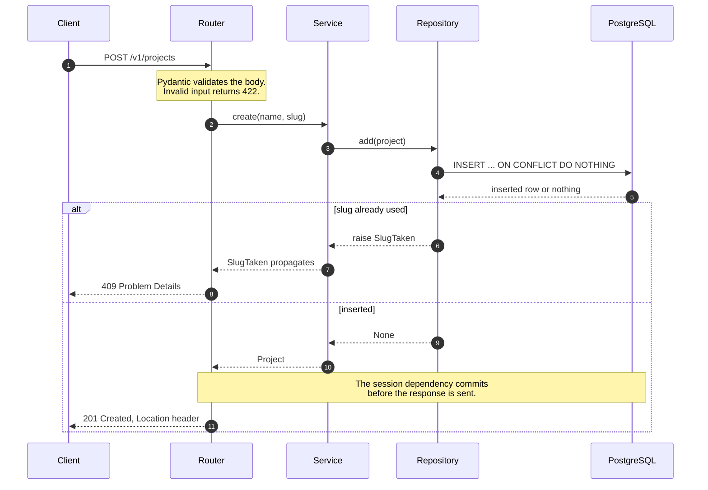

[Engineering handbook](../../README.md) / Backend

# FastAPI architecture

Buildruntime backend services are written in Python with FastAPI, Pydantic, SQLAlchemy and PostgreSQL. This page describes how a service is laid out and how a request travels through it. It builds on the domain and service code in [Clean architecture](../principles/clean-architecture.md).

## Project layout

Organise code by feature. Each feature package holds its own domain, service, repository, schemas and router. Shared infrastructure lives in `app/core`, `app/db` and `app/api`. Every directory under `app/` and `tests/` is a package with an empty `__init__.py`, left out of the tree below. Without them, mypy cannot map files to module names reliably.

```text
.
├── app/
│   ├── main.py                # Application factory and lifespan
│   ├── core/
│   │   ├── config.py          # Settings, read from the environment
│   │   ├── errors.py          # Domain error base classes
│   │   ├── cache.py           # Redis cache helper
│   │   └── rate_limit.py      # Redis rate limiter
│   ├── db/
│   │   ├── base.py            # Declarative base and naming conventions
│   │   └── session.py         # Engine and session dependency
│   ├── api/
│   │   ├── health.py          # Liveness and readiness endpoints
│   │   ├── pagination.py      # Cursor encoding
│   │   └── problems.py        # Error responses
│   └── projects/
│       ├── domain.py          # Entity and domain errors
│       ├── ports.py           # Repository protocol
│       ├── service.py         # Use cases
│       ├── models.py          # SQLAlchemy table mapping
│       ├── repository.py      # SQL implementation of the port
│       ├── schemas.py         # Request and response models
│       └── router.py          # HTTP endpoints
├── migrations/                # Alembic environment and versions
├── tests/
├── alembic.ini
├── pyproject.toml
└── uv.lock
```

## Request flow



## Tooling

Dependencies and tools are declared in `pyproject.toml` and locked with [uv](https://docs.astral.sh/uv/). The lock file is committed. Ruff formats and lints, and mypy type-checks in strict mode.

```toml
# pyproject.toml
[project]
name = "projects-api"
version = "1.0.0"
requires-python = ">=3.13"
dependencies = [
    "fastapi[standard]>=0.162",
    "pydantic-settings>=2.16",
    "sqlalchemy[asyncio]>=2.1",
    "asyncpg>=0.32",
    "alembic>=1.20",
    "redis>=8.1",
]

[dependency-groups]
dev = [
    "pytest>=9.2",
    "httpx>=0.28",
    "mypy>=2.4",
    "ruff>=0.17",
]

[tool.ruff]
line-length = 100
target-version = "py313"

[tool.ruff.lint]
select = ["E", "F", "I", "B", "UP", "S", "ASYNC", "RUF"]

[tool.ruff.lint.per-file-ignores]
"tests/**" = ["S101"]

[tool.mypy]
strict = true
plugins = ["pydantic.mypy"]

[tool.pytest.ini_options]
testpaths = ["tests"]
pythonpath = ["."]
addopts = ["-ra", "--strict-markers", "--strict-config"]
xfail_strict = true
```

Common commands:

```bash
uv sync                                  # Install, including the dev group
uv run ruff format . && uv run ruff check .
uv run mypy app tests
uv run pytest
uv run uvicorn app.main:create_app --factory --reload   # Development server
```

## Settings

All configuration comes from environment variables, read once at start-up by a Pydantic settings class. A missing or malformed value stops the process with a clear error. Nothing else in the code reads `os.environ`.

```python
# app/core/config.py
from functools import lru_cache
from typing import Literal

from pydantic import Field, PostgresDsn, RedisDsn
from pydantic_settings import BaseSettings, SettingsConfigDict


class Settings(BaseSettings):
    model_config = SettingsConfigDict(env_prefix="APP_", env_file=".env", extra="ignore")

    environment: Literal["development", "test", "production"] = "development"
    database_url: PostgresDsn
    database_pool_size: int = Field(default=5, ge=1, le=50)
    redis_url: RedisDsn
    log_level: Literal["DEBUG", "INFO", "WARNING", "ERROR"] = "INFO"


@lru_cache
def get_settings() -> Settings:
    return Settings()
```

`.env` is for local development only and is listed in `.gitignore`. Commit a `.env.example` with every variable and safe placeholder values instead.

## Database models

The SQLAlchemy base sets a naming convention, so that every constraint and index gets a predictable name. Migrations and error handling can then refer to them by name.

```python
# app/db/base.py
from sqlalchemy import MetaData
from sqlalchemy.orm import DeclarativeBase

NAMING_CONVENTION = {
    "ix": "ix_%(table_name)s_%(column_0_N_name)s",
    "uq": "uq_%(table_name)s_%(column_0_N_name)s",
    "ck": "ck_%(table_name)s_%(constraint_name)s",
    "fk": "fk_%(table_name)s_%(column_0_name)s_%(referred_table_name)s",
    "pk": "pk_%(table_name)s",
}


class Base(DeclarativeBase):
    metadata = MetaData(naming_convention=NAMING_CONVENTION)
```

Table mappings are separate from the domain entity. The repository converts between them.

```python
# app/projects/models.py
from datetime import datetime
from uuid import UUID

from sqlalchemy import CheckConstraint, DateTime, Index, String, func
from sqlalchemy.orm import Mapped, mapped_column

from app.db.base import Base


class ProjectRow(Base):
    __tablename__ = "projects"

    id: Mapped[UUID] = mapped_column(primary_key=True)
    slug: Mapped[str] = mapped_column(String(63), unique=True)
    name: Mapped[str] = mapped_column(String(200))
    created_at: Mapped[datetime] = mapped_column(DateTime(timezone=True), server_default=func.now())
    archived_at: Mapped[datetime | None] = mapped_column(DateTime(timezone=True))

    __table_args__ = (
        CheckConstraint("slug ~ '^[a-z0-9]+(-[a-z0-9]+)*$'", name="slug_format"),
        Index(None, "created_at", "id"),
    )
```

## Sessions and transactions

The engine and session factory are created once, in the application's lifespan. Each request gets its own session inside a transaction: it commits if the endpoint succeeds and rolls back if it raises.

```python
# app/db/session.py
from collections.abc import AsyncIterator

from fastapi import Request
from sqlalchemy.ext.asyncio import AsyncEngine, AsyncSession, create_async_engine

from app.core.config import Settings


def create_engine(settings: Settings) -> AsyncEngine:
    return create_async_engine(
        str(settings.database_url),
        pool_size=settings.database_pool_size,
        pool_pre_ping=True,
    )


async def get_session(request: Request) -> AsyncIterator[AsyncSession]:
    async with request.app.state.sessionmaker() as session, session.begin():
        yield session
```

Declare the dependency with `scope="function"`, as the router below does. By default, FastAPI runs the code after `yield` once the response has already been sent. A commit that failed at that point would leave the client with a `201 Created` for data that was never stored. With `scope="function"`, the commit runs before the response is sent, and a failure produces an error response.

## Repositories

The repository implements the port from the domain layer. It is the only code in the feature that builds SQL.

```python
# app/projects/repository.py
from datetime import datetime
from uuid import UUID

from sqlalchemy import select, tuple_, update
from sqlalchemy.dialects.postgresql import insert
from sqlalchemy.ext.asyncio import AsyncSession

from app.projects.domain import Project, SlugTaken
from app.projects.models import ProjectRow


def _to_domain(row: ProjectRow) -> Project:
    return Project(
        id=row.id,
        slug=row.slug,
        name=row.name,
        created_at=row.created_at,
        archived_at=row.archived_at,
    )


class SqlProjectRepository:
    def __init__(self, session: AsyncSession) -> None:
        self._session = session

    async def get_by_slug(self, slug: str) -> Project | None:
        row = await self._session.scalar(select(ProjectRow).where(ProjectRow.slug == slug))
        return _to_domain(row) if row else None

    async def add(self, project: Project) -> None:
        inserted = await self._session.scalar(
            insert(ProjectRow)
            .values(
                id=project.id,
                slug=project.slug,
                name=project.name,
                created_at=project.created_at,
            )
            .on_conflict_do_nothing(index_elements=[ProjectRow.slug])
            .returning(ProjectRow.id)
        )
        if inserted is None:
            raise SlugTaken(project.slug)

    async def update(self, project: Project) -> None:
        await self._session.execute(
            update(ProjectRow)
            .where(ProjectRow.id == project.id)
            .values(name=project.name, archived_at=project.archived_at)
        )

    async def list_page(self, *, after: tuple[datetime, UUID] | None, limit: int) -> list[Project]:
        query = (
            select(ProjectRow)
            .order_by(ProjectRow.created_at.desc(), ProjectRow.id.desc())
            .limit(limit)
        )
        if after is not None:
            query = query.where(tuple_(ProjectRow.created_at, ProjectRow.id) < after)
        return [_to_domain(row) for row in await self._session.scalars(query)]
```

`add` uses `INSERT ... ON CONFLICT DO NOTHING` rather than catching `IntegrityError`. In PostgreSQL, a failed statement aborts the whole transaction, so catching the error would leave the session unusable for anything else in the request.

## Schemas

Request and response models are Pydantic models, separate from both the entity and the table mapping. Request models reject unknown fields, so that a misspelt field is an error rather than silently ignored.

```python
# app/projects/schemas.py
from datetime import datetime
from typing import Annotated
from uuid import UUID

from pydantic import BaseModel, ConfigDict, StringConstraints

Slug = Annotated[
    str, StringConstraints(pattern=r"^[a-z0-9]+(-[a-z0-9]+)*$", min_length=1, max_length=63)
]
Name = Annotated[str, StringConstraints(strip_whitespace=True, min_length=1, max_length=200)]


class ProjectCreate(BaseModel):
    model_config = ConfigDict(extra="forbid")

    name: Name
    slug: Slug


class ProjectOut(BaseModel):
    model_config = ConfigDict(from_attributes=True)

    id: UUID
    slug: str
    name: str
    created_at: datetime
    archived_at: datetime | None


class ProjectPage(BaseModel):
    items: list[ProjectOut]
    next_cursor: str | None
```

## Routers

Routers are thin. They validate input through the schemas, call one service method, and shape the response. Dependencies are declared once as `Annotated` aliases.

```python
# app/projects/router.py
from typing import Annotated

from fastapi import APIRouter, Depends, Query, Response, status
from sqlalchemy.ext.asyncio import AsyncSession

from app.api.pagination import decode_cursor, encode_cursor
from app.db.session import get_session
from app.projects.repository import SqlProjectRepository
from app.projects.schemas import ProjectCreate, ProjectOut, ProjectPage
from app.projects.service import ProjectService

router = APIRouter(prefix="/projects", tags=["projects"])

SessionDep = Annotated[AsyncSession, Depends(get_session, scope="function")]


def get_project_service(session: SessionDep) -> ProjectService:
    return ProjectService(SqlProjectRepository(session))


ServiceDep = Annotated[ProjectService, Depends(get_project_service)]


@router.post("", status_code=status.HTTP_201_CREATED)
async def create_project(
    body: ProjectCreate, service: ServiceDep, response: Response
) -> ProjectOut:
    project = await service.create(name=body.name, slug=body.slug)
    response.headers["Location"] = f"/v1/projects/{project.slug}"
    return ProjectOut.model_validate(project)


@router.get("")
async def list_projects(
    service: ServiceDep,
    cursor: str | None = None,
    limit: Annotated[int, Query(ge=1, le=100)] = 20,
) -> ProjectPage:
    after = decode_cursor(cursor) if cursor else None
    projects = await service.list_page(after=after, limit=limit + 1)
    page, more = projects[:limit], len(projects) > limit
    return ProjectPage(
        items=[ProjectOut.model_validate(p) for p in page],
        next_cursor=encode_cursor(page[-1].created_at, page[-1].id) if more else None,
    )


@router.get("/{slug}")
async def get_project(slug: str, service: ServiceDep) -> ProjectOut:
    return ProjectOut.model_validate(await service.get(slug))


@router.post("/{slug}/archive")
async def archive_project(slug: str, service: ServiceDep) -> ProjectOut:
    return ProjectOut.model_validate(await service.archive(slug))
```

The list endpoint asks for one more item than the page size. If it gets it, there is a next page. This avoids a separate `COUNT` query.

## Health checks

A service exposes two endpoints. Liveness says the process is running and must not touch dependencies, or a database outage would cause every instance to be restarted. Readiness says the instance can serve traffic.

```python
# app/api/health.py
from fastapi import APIRouter, Request, Response, status
from sqlalchemy import text

router = APIRouter(tags=["health"])


@router.get("/health/live")
async def live() -> dict[str, str]:
    return {"status": "ok"}


@router.get("/health/ready")
async def ready(request: Request, response: Response) -> dict[str, str]:
    try:
        async with request.app.state.sessionmaker() as session:
            await session.execute(text("SELECT 1"))
        await request.app.state.redis.ping()
    except Exception:
        response.status_code = status.HTTP_503_SERVICE_UNAVAILABLE
        return {"status": "unavailable"}
    return {"status": "ok"}
```

## Application factory

The application is built by a function, so that tests can create it with their own settings. The lifespan opens connection pools on start-up and closes them on shutdown.

```python
# app/main.py
from collections.abc import AsyncIterator
from contextlib import asynccontextmanager

from fastapi import FastAPI
from redis.asyncio import Redis
from sqlalchemy.ext.asyncio import async_sessionmaker

from app.api import health
from app.api.problems import register_problem_handlers
from app.core.config import Settings, get_settings
from app.db.session import create_engine
from app.projects import router as projects


@asynccontextmanager
async def lifespan(app: FastAPI) -> AsyncIterator[None]:
    settings: Settings = app.state.settings
    engine = create_engine(settings)
    app.state.sessionmaker = async_sessionmaker(engine, expire_on_commit=False)
    app.state.redis = Redis.from_url(str(settings.redis_url), decode_responses=True)
    try:
        yield
    finally:
        await app.state.redis.aclose()
        await engine.dispose()


def create_app(settings: Settings | None = None) -> FastAPI:
    settings = settings or get_settings()
    app = FastAPI(title="Projects API", version="1.0.0", lifespan=lifespan)
    app.state.settings = settings
    register_problem_handlers(app)
    app.include_router(health.router)
    app.include_router(projects.router, prefix="/v1")
    return app
```

Run it with the factory flag, so that settings are not read at import time:

```bash
uv run uvicorn app.main:create_app --factory --host 0.0.0.0 --port 8000
```

## Async code

FastAPI endpoints in Buildruntime services are `async`. That has one hard rule: **never block the event loop.** A blocking call in an async function stops every other request on that worker until it returns.

- Use async drivers and clients: `asyncpg` through SQLAlchemy, `redis.asyncio`, `httpx.AsyncClient`.
- Run unavoidable blocking or CPU-heavy work in a thread with `await anyio.to_thread.run_sync(func)`, or move it to a background worker.
- Do not use `time.sleep`, `requests`, or synchronous file I/O on large files inside an endpoint. Ruff's `ASYNC` rules catch the common cases.
- Set timeouts on every outbound call. A dependency that never responds should not hold a request open forever.

`BackgroundTasks` runs work after the response is sent, in the same process. Use it only for work that may be lost if the process stops, such as a best-effort notification. Work that must happen belongs in a job queue with retries.

## Related

- [REST API design](api-design.md)
- [Error handling](error-handling.md)
- [Database design](../data/database-design.md)
- [Pytest](../quality/pytest.md)
