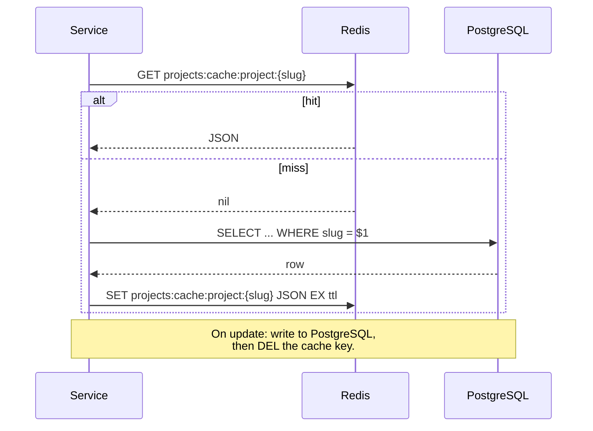

[Engineering handbook](../../README.md) / Data

# Redis

Redis holds data that is fast to rebuild and acceptable to lose: caches, rate-limit counters, short-lived tokens and locks that guard against duplicate work. PostgreSQL remains the system of record. If losing everything in Redis would lose information that exists nowhere else, that information belongs in PostgreSQL.

## What to use it for

| Use | Pattern | Notes |
| :-- | :-- | :-- |
| Caching | Cache-aside, with a TTL | See [Caching](#caching). |
| Rate limiting | `INCR` with expiry | See [Rate limiting](#rate-limiting). |
| Short-lived state | `SET key value EX seconds` | One-time codes, upload sessions. |
| Avoiding duplicate work | `SET key value NX EX seconds` | Best effort only. See [Locks](#locks). |
| Pub/sub notifications | `PUBLISH` / `SUBSCRIBE` | Messages are lost if no subscriber is listening. Not a job queue. |

Not for: primary storage of anything, job queues that must not lose jobs (use PostgreSQL, see [Work queues](postgresql.md#work-queues), or a dedicated broker), or large values. A value over about 100 KB slows down every command queued behind it.

## Keys

- Prefix every key with the service and purpose, separated by colons: `projects:cache:project:website-redesign`, `projects:rate:create:203.0.113.7:29560321`. Several services can then share an instance, and you can find and count keys by prefix with `SCAN`.
- Every key has a TTL, unless something else deletes it and you have checked that it does. A key without a TTL is a memory leak.
- Never use `KEYS` in application code. It blocks the server while it walks every key. Use `SCAN`, or better, structure keys so that you never need to search.

## Caching

The cache-aside pattern: read from the cache, and on a miss load from the database and store the result.



A small helper keeps serialisation, key prefixes and TTLs in one place. It uses a Pydantic `TypeAdapter`, so that it can cache dataclasses such as the `Project` entity as well as models.

```python
# app/core/cache.py
import random
from collections.abc import Awaitable, Callable
from datetime import timedelta

from pydantic import TypeAdapter
from redis.asyncio import Redis


class JsonCache[T]:
    def __init__(self, redis: Redis, *, namespace: str, type_: type[T], ttl: timedelta) -> None:
        self._redis = redis
        self._namespace = namespace
        self._adapter = TypeAdapter(type_)
        self._ttl = ttl

    def _key(self, key: str) -> str:
        return f"{self._namespace}:{key}"

    async def get_or_load(self, key: str, load: Callable[[], Awaitable[T | None]]) -> T | None:
        cached = await self._redis.get(self._key(key))
        if cached is not None:
            return self._adapter.validate_json(cached)
        value = await load()
        if value is not None:
            # Spread expiry times, so that keys cached together do not expire together.
            ttl = self._ttl * random.uniform(0.9, 1.1)  # noqa: S311  # Not security-related.
            await self._redis.set(self._key(key), self._adapter.dump_json(value), ex=ttl)
        return value

    async def invalidate(self, key: str) -> None:
        await self._redis.delete(self._key(key))
```

Caching fits into the architecture as another implementation of the repository port. It wraps the SQL repository, and the service does not know that caching exists:

```python
# app/projects/cached_repository.py
from datetime import datetime
from uuid import UUID

from app.core.cache import JsonCache
from app.projects.domain import Project
from app.projects.ports import ProjectRepository


class CachedProjectRepository:
    def __init__(self, inner: ProjectRepository, cache: JsonCache[Project]) -> None:
        self._inner = inner
        self._cache = cache

    async def get_by_slug(self, slug: str) -> Project | None:
        return await self._cache.get_or_load(slug, lambda: self._inner.get_by_slug(slug))

    async def add(self, project: Project) -> None:
        await self._inner.add(project)

    async def update(self, project: Project) -> None:
        await self._inner.update(project)
        await self._cache.invalidate(project.slug)

    async def list_page(self, *, after: tuple[datetime, UUID] | None, limit: int) -> list[Project]:
        return await self._inner.list_page(after=after, limit=limit)
```

Rules for caching:

- **Cache only what you have measured to be slow or frequent.** Every cache adds a way for users to see stale data.
- **Decide how stale is acceptable, and set the TTL to match.** The TTL is the upper bound on staleness if an invalidation is missed.
- **Invalidate after the write.** `update` above deletes the key before the request's transaction commits. A read in between can cache the old value again, until the TTL expires. Where that matters, invalidate after the commit, or keep the TTL short.
- **Delete on change rather than updating the cached value.** Two concurrent writers that both update the cache can leave it with the older value.
- **Treat Redis as optional.** If Redis is down, a cache read should fail fast and fall through to the database, with a short socket timeout on the client.

## Rate limiting

A fixed-window counter is simple and is enough for most limits. Each window has its own key, which expires with the window.

```python
# app/core/rate_limit.py
import time
from collections.abc import Awaitable, Callable
from dataclasses import dataclass

from fastapi import HTTPException, Request, status
from redis.asyncio import Redis


@dataclass(frozen=True, slots=True)
class RateLimitResult:
    allowed: bool
    remaining: int
    retry_after: int


async def hit(redis: Redis, key: str, *, limit: int, window_seconds: int) -> RateLimitResult:
    now = int(time.time())
    window_key = f"{key}:{now // window_seconds}"
    async with redis.pipeline(transaction=True) as pipe:
        pipe.incr(window_key)
        pipe.expire(window_key, window_seconds, nx=True)
        count, _ = await pipe.execute()
    allowed = count <= limit
    return RateLimitResult(
        allowed=allowed,
        remaining=max(limit - count, 0),
        retry_after=0 if allowed else window_seconds - now % window_seconds,
    )


def rate_limit(
    *, name: str, limit: int, window_seconds: int
) -> Callable[[Request], Awaitable[None]]:
    """A FastAPI dependency that limits requests per client address."""

    async def dependency(request: Request) -> None:
        client = request.client.host if request.client else "unknown"
        result = await hit(
            request.app.state.redis,
            f"projects:rate:{name}:{client}",
            limit=limit,
            window_seconds=window_seconds,
        )
        if not result.allowed:
            raise HTTPException(
                status.HTTP_429_TOO_MANY_REQUESTS,
                detail="Too many requests. Try again later.",
                headers={"Retry-After": str(result.retry_after)},
            )

    return dependency
```

Apply it to a route with `dependencies=[Depends(rate_limit(name="create", limit=10, window_seconds=60))]`. The error handler turns the `HTTPException` into a Problem Details response and keeps the `Retry-After` header (see [Error handling](../backend/error-handling.md)).

A fixed window allows up to twice the limit in a short burst across a window boundary. If that matters, use a sliding window, or the limiting features of the API gateway or load balancer.

Behind a reverse proxy, `request.client.host` is the proxy's address. Configure Uvicorn's `--forwarded-allow-ips` with the proxy's address, so that it takes the client address from `X-Forwarded-For`, and never trust that header from anywhere else.

## Locks

`SET key token NX EX 30` succeeds for one caller at a time, and can stop two workers doing the same expensive job at once. It is not a guarantee: if the holder pauses for longer than the expiry, for example during a long garbage collection, a second worker can take the lock while the first still thinks it holds it.

Use Redis locks only where running twice is wasteful but harmless. Where it would be wrong, enforce correctness in PostgreSQL: with a unique constraint, a row lock, or an advisory lock held inside the transaction that does the work.

## Operating Redis

- **Eviction.** An instance used only for caching sets `maxmemory` and `maxmemory-policy allkeys-lru`, so that it evicts old keys instead of rejecting writes. An instance that holds anything else uses `noeviction` and is monitored for memory use.
- **Persistence.** A cache needs none. Rate limits and short-lived state can tolerate loss on restart. If losing the data on a restart is not acceptable, reconsider whether it belongs in Redis.
- **Timeouts.** Set `socket_timeout` and `socket_connect_timeout` on the client. A slow Redis should not make every request slow.

## Related

- [PostgreSQL](postgresql.md)
- [Performance](../quality/performance.md)
- [FastAPI architecture](../backend/fastapi-architecture.md)
