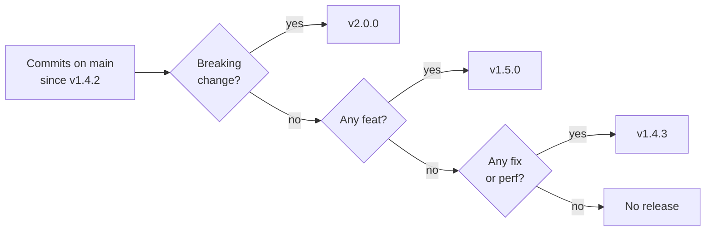

[Engineering handbook](../../README.md) / Delivery

# Versioning and releases

Buildruntime libraries, tools and services are versioned with [Semantic Versioning 2.0.0](https://semver.org/). Version numbers tell users what an upgrade means for them, and the changelog tells them what changed. Both are derived from the commit history, which is why commits follow [Conventional Commits](../workflow/conventional-commits.md).

## Semantic Versioning

A version is `MAJOR.MINOR.PATCH`:

| Part | Increment when | Example |
| :-- | :-- | :-- |
| `MAJOR` | A change breaks compatibility for existing users. | `1.4.2` → `2.0.0` |
| `MINOR` | Functionality is added in a backwards-compatible way. | `1.4.2` → `1.5.0` |
| `PATCH` | Bugs are fixed in a backwards-compatible way. | `1.4.2` → `1.4.3` |

What counts as the public interface, and so what counts as breaking, depends on what is released:

- **A library:** its documented API, including the behaviour of functions, their arguments and the exceptions they raise.
- **A CLI tool:** its commands, options, exit codes and machine-readable output.
- **An HTTP service:** its API contract. Services also carry the major API version in the URL (`/v1`), which changes only when the API breaks (see [Versioning](../backend/api-design.md#versioning)). The service's own version number then mostly tracks deployments.

Two special cases:

- **`0.y.z`** is initial development: anything may change at any time. Use it until the interface is stable enough for others to depend on, then release `1.0.0`. Do not stay on `0.x` indefinitely to avoid committing to compatibility.
- **Pre-releases** such as `2.0.0-rc.1` let users try a version before it is final. They sort before the release: `2.0.0-rc.1` < `2.0.0`.

## From commits to versions

The commit types since the last release determine the next version:

| Commits since the last release include | Next version |
| :-- | :-- |
| A breaking change (`feat!:`, `fix!:`, or a `BREAKING CHANGE:` footer) | Next major |
| At least one `feat:` | Next minor |
| Only `fix:` or `perf:` | Next patch |
| Only `docs:`, `test:`, `ci:`, `chore:` or `refactor:` | No release needed |



A tool such as release-please or semantic-release can do this automatically: it opens a release pull request with the version and changelog, and tags the release when that pull request is merged. Whether to automate is a choice for each project. The rules are the same either way.

## Changelog

Every released project has a `CHANGELOG.md` in the format of [Keep a Changelog](https://keepachangelog.com/en/1.1.0/). It is written for users, not developers: say what changed for them, not which files were touched.

```markdown
# Changelog

## [Unreleased]

## [1.5.0] - 2026-03-12

### Added

- Projects can be archived with `POST /v1/projects/{slug}/archive`.

### Fixed

- Listing projects no longer skips projects created in the same millisecond.

### Deprecated

- The `status` query parameter of `GET /v1/projects` will be removed in 2.0.0.
  Use `archived=true` instead.

## [1.4.2] - 2026-02-20

### Security

- Updated `jinja2` to 3.1.6 to fix a sandbox escape (CVE-2025-27516).

[Unreleased]: https://github.com/OWNER/REPOSITORY/compare/v1.5.0...HEAD
[1.5.0]: https://github.com/OWNER/REPOSITORY/compare/v1.4.2...v1.5.0
[1.4.2]: https://github.com/OWNER/REPOSITORY/compare/v1.4.1...v1.4.2
```

Use the sections `Added`, `Changed`, `Deprecated`, `Removed`, `Fixed` and `Security`, and leave out the ones that are empty. Breaking changes are listed under `Changed` or `Removed`, and say what users must do.

## Releasing

Releases are made from `main`. A release is a Git tag on a commit that has passed the full pipeline.

1. Check that the pipeline on `main` is green, and that `CHANGELOG.md` describes every user-facing change under `Unreleased`.
2. Update the version where the project declares it, such as `pyproject.toml` or `package.json`, and move the `Unreleased` entries under the new version with today's date. Commit this as `chore(release): 1.5.0`, through a pull request like any other change.
3. Tag the merged commit with an annotated tag, and push it:

   ```bash
   git switch main && git pull --ff-only
   git tag -a v1.5.0 -m "v1.5.0"
   git push origin v1.5.0
   ```

4. The release workflow, triggered by the tag, builds and publishes the artefacts: the package, or the container image tagged `1.5.0`.
5. Create a GitHub release from the tag, with the changelog section for the version as its notes.

Tags are `v` followed by the version: `v1.5.0`. Never move or delete a tag that has been pushed. If a release is wrong, release a new version.

## Fixing a released version

The usual fix is a new patch release from `main`: fix the bug with a `fix:` commit, and release.

When users need a fix for an older line while `main` has moved on, for example `1.4.x` after `2.0.0` is out, create a release branch from the last tag of that line, and cherry-pick the fix onto it:

```bash
FIX_SHA=3f9c2e1   # The commit on main that fixed the bug.
git switch -c release/1.4 v1.4.2
git cherry-pick -x "$FIX_SHA"
git push -u origin release/1.4
# Open a pull request against release/1.4, merge it, then tag v1.4.3 on that branch.
```

Create a release branch only when someone needs it. Which older lines receive fixes is stated in the project's `SECURITY.md`, if it differs from the default of fixing the latest release only.

## Deprecation

Removing something users depend on happens in two steps, at least one minor release apart:

1. **Deprecate.** Keep it working, document the replacement, and warn: a `DeprecationWarning` in Python, `deprecated` in the OpenAPI document, a note in the changelog.
2. **Remove**, in the next major release, with an entry under `Removed` that says what to use instead.

## Related

- [Conventional Commits](../workflow/conventional-commits.md)
- [Git workflow](../workflow/git-workflow.md)
- [CI/CD](ci-cd.md)
