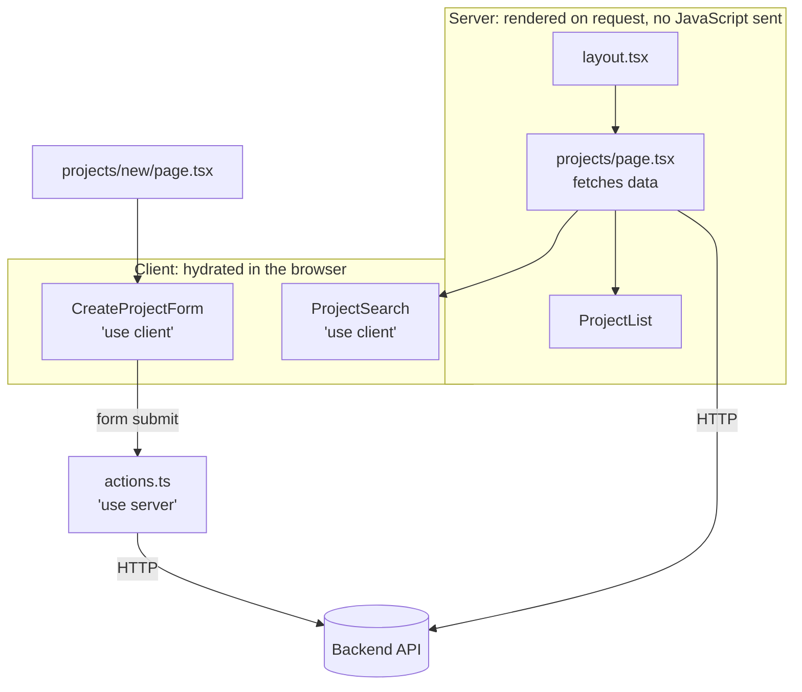

[Engineering handbook](../../README.md) / Frontend

# Next.js

Buildruntime web applications use Next.js with the App Router. Pages render on the server by default, and fetch data from the backend API on the server. Client-side JavaScript is added where a page needs interaction. This page follows one feature through the application: listing, viewing and creating projects, against the API from [FastAPI architecture](../backend/fastapi-architecture.md).

## Project structure

```text
.
├── app/
│   ├── layout.tsx                 # Root layout: <html>, <body>, global styles
│   ├── globals.css
│   ├── api/
│   │   └── health/route.ts        # Health check for the container platform
│   └── projects/
│       ├── page.tsx               # /projects
│       ├── loading.tsx            # Shown while page.tsx loads
│       ├── error.tsx              # Shown if page.tsx throws
│       ├── actions.ts             # Server Actions for this feature
│       ├── new/
│       │   ├── page.tsx           # /projects/new
│       │   └── create-project-form.tsx
│       └── [slug]/
│           ├── page.tsx           # /projects/website-redesign
│           └── not-found.tsx
├── components/                    # Shared components
├── hooks/                         # Shared client hooks
├── lib/
│   ├── env.ts                     # Validated environment variables
│   └── api/                       # Server-only API client
├── e2e/                           # Playwright tests
├── instrumentation.ts
├── next.config.ts
└── playwright.config.ts
```

- Code used by one route lives next to that route. Code shared by several moves to `components/`, `hooks/` or `lib/`.
- Import with the `@/` alias rather than long relative paths.
- Data access lives in `lib/api/`. Components call functions such as `getProject(slug)`, and never call `fetch` with a URL themselves.

## Server and Client Components

Components in the `app/` directory are Server Components unless a file starts with `"use client"`. Server Components run only on the server: they can read secrets, call the API directly, and add no JavaScript to the page.



Keep `"use client"` at the leaves. Mark the smallest component that needs state, effects or browser APIs, not the page that contains it. Everything a Client Component imports becomes part of the browser bundle.

Props passed from a Server Component to a Client Component must be serialisable: plain objects, arrays, strings, numbers, dates. Functions cannot be passed, except Server Actions.

## Environment variables

- Variables without a prefix are available only on the server. Read them through the validated `env()` function in `lib/env.ts` (see [TypeScript](typescript.md#validating-data-at-the-boundary)).
- Variables prefixed `NEXT_PUBLIC_` are inlined into the browser bundle **at build time**. Never put a secret in one. Changing one needs a rebuild, not a restart.
- Commit a `.env.example` listing every variable. `.env.local` is for local values and is not committed.

Check the server's variables when it starts, rather than on the first request that needs them. Next.js calls `register` in `instrumentation.ts` once, when the server starts:

```ts
// instrumentation.ts
export async function register() {
  if (process.env.NEXT_RUNTIME === "nodejs") {
    const { env } = await import("@/lib/env");
    env();
  }
}
```

## Fetching data

Server Components fetch data with `async`/`await`. The API client is a server-only module that adds authentication and a timeout, and converts error responses into the `ApiError` type from [Error handling](../backend/error-handling.md#handling-errors-on-the-frontend).

```ts
// lib/api/client.ts
import "server-only";
import { toApiError } from "@/lib/api/problem";
import { env } from "@/lib/env";

export async function apiFetch(
  path: string,
  init: RequestInit = {},
): Promise<Response> {
  const headers = new Headers(init.headers);
  headers.set("Authorization", `Bearer ${env().API_TOKEN}`);
  headers.set("Accept", "application/json");
  if (init.body) headers.set("Content-Type", "application/json");

  const response = await fetch(new URL(path, env().API_URL), {
    ...init,
    headers,
    signal: init.signal ?? AbortSignal.timeout(10_000),
  });
  if (!response.ok) {
    throw await toApiError(response);
  }
  return response;
}
```

```ts
// lib/api/projects.ts
import "server-only";
import { cache } from "react";
import { apiFetch } from "@/lib/api/client";
import { ApiError } from "@/lib/api/problem";
import {
  type Project,
  type ProjectPage,
  projectPageSchema,
  projectSchema,
} from "@/lib/api/schemas";

// cache() shares one result between generateMetadata and the page in the same request.
export const getProject = cache(
  async (slug: string): Promise<Project | null> => {
    try {
      const response = await apiFetch(
        `/v1/projects/${encodeURIComponent(slug)}`,
      );
      return projectSchema.parse(await response.json());
    } catch (error) {
      if (error instanceof ApiError && error.code === "not_found") return null;
      throw error;
    }
  },
);

export async function listProjects(cursor?: string): Promise<ProjectPage> {
  const params = new URLSearchParams({ limit: "20" });
  if (cursor) params.set("cursor", cursor);
  const response = await apiFetch(`/v1/projects?${params.toString()}`);
  return projectPageSchema.parse(await response.json());
}

export async function createProject(input: {
  name: string;
  slug: string;
}): Promise<Project> {
  const response = await apiFetch("/v1/projects", {
    method: "POST",
    body: JSON.stringify(input),
  });
  return projectSchema.parse(await response.json());
}
```

Pages receive `params` and `searchParams` as promises. Await them before use:

```tsx
// app/projects/page.tsx
import type { Metadata } from "next";
import Link from "next/link";
import { ProjectList } from "@/components/project-list";
import { listProjects } from "@/lib/api/projects";

export const metadata: Metadata = { title: "Projects" };

type ProjectsPageProps = {
  searchParams: Promise<Record<string, string | string[] | undefined>>;
};

export default async function ProjectsPage({
  searchParams,
}: ProjectsPageProps) {
  const { cursor } = await searchParams;
  const page = await listProjects(
    typeof cursor === "string" ? cursor : undefined,
  );

  return (
    <main>
      <h1>Projects</h1>
      <p>
        <Link href="/projects/new">New project</Link>
      </p>
      <ProjectList projects={page.items} />
      {page.next_cursor && (
        <Link href={`/projects?cursor=${encodeURIComponent(page.next_cursor)}`}>
          Next page
        </Link>
      )}
    </main>
  );
}
```

```tsx
// app/projects/[slug]/page.tsx
import type { Metadata } from "next";
import { notFound } from "next/navigation";
import { getProject } from "@/lib/api/projects";

type ProjectPageProps = {
  params: Promise<{ slug: string }>;
};

export async function generateMetadata({
  params,
}: ProjectPageProps): Promise<Metadata> {
  const project = await getProject((await params).slug);
  return { title: project?.name ?? "Project not found" };
}

export default async function ProjectPage({ params }: ProjectPageProps) {
  const project = await getProject((await params).slug);
  if (!project) notFound();

  return (
    <main>
      <h1>{project.name}</h1>
      <dl>
        <dt>Slug</dt>
        <dd>{project.slug}</dd>
        <dt>Created</dt>
        <dd>
          <time dateTime={project.created_at}>
            {new Date(project.created_at).toLocaleDateString("en-GB", {
              dateStyle: "long",
            })}
          </time>
        </dd>
      </dl>
    </main>
  );
}
```

Requests that do not depend on each other should run in parallel, with `Promise.all`, not one after another.

## Caching

Caching behaviour in Next.js has changed between major versions, so do not rely on defaults. Since Next.js 15, `fetch` responses and `GET` route handlers are not cached unless you ask for it. Buildruntime applications follow these rules:

- Data that belongs to a user, or changes often, is fetched on every request. This is the default for the examples on this page.
- Data that is the same for everyone and changes rarely may be cached, with an explicit lifetime: `fetch(url, { next: { revalidate: 300 } })`.
- After a Server Action changes data, call `revalidatePath` or `revalidateTag` for the pages that show it.
- The newer caching model, enabled with `cacheComponents` in `next.config.ts` and the `"use cache"` directive, is adopted per project with a decision record (see [Recording decisions](../principles/engineering-principles.md#recording-decisions)), because it changes how every page is rendered.

## Loading and error states

Every route segment that fetches data has a `loading.tsx` and an `error.tsx`.

```tsx
// app/projects/loading.tsx
export default function Loading() {
  return <p aria-busy="true">Loading projects…</p>;
}
```

`error.tsx` must be a Client Component. It receives the error and a `reset` function that renders the segment again. In production, Next.js replaces the message of errors thrown in Server Components with a generic one, and provides a `digest` that matches the server log entry.

```tsx
// app/projects/error.tsx
"use client";

type ErrorProps = {
  error: Error & { digest?: string };
  reset: () => void;
};

export default function ProjectsError({ error, reset }: ErrorProps) {
  return (
    <main>
      <h1>Projects could not be loaded</h1>
      <p>
        Try again. If the problem continues, quote this reference:{" "}
        {error.digest ?? "none"}.
      </p>
      <button type="button" onClick={reset}>
        Try again
      </button>
    </main>
  );
}
```

```tsx
// app/projects/[slug]/not-found.tsx
import Link from "next/link";

export default function ProjectNotFound() {
  return (
    <main>
      <h1>Project not found</h1>
      <p>
        It may have been renamed or removed.{" "}
        <Link href="/projects">See all projects</Link>.
      </p>
    </main>
  );
}
```

## Server Actions

Forms submit to Server Actions: functions that run on the server, marked with `"use server"`. A Server Action is a public HTTP endpoint, whatever page it is used on. It must validate its input and check that the user may perform the action, every time.

The action returns expected failures, such as validation errors or a slug that is in use, as state for the form to show. It throws unexpected errors, which the nearest `error.tsx` renders.

```ts
// app/projects/actions.ts
"use server";

import { revalidatePath } from "next/cache";
import { redirect } from "next/navigation";
import { z } from "zod";
import { ApiError } from "@/lib/api/problem";
import { createProject } from "@/lib/api/projects";

const createProjectSchema = z.object({
  name: z
    .string()
    .trim()
    .min(1, "Enter a name.")
    .max(200, "Use 200 characters or fewer."),
  slug: z
    .string()
    .max(63, "Use 63 characters or fewer.")
    .regex(
      /^[a-z0-9]+(-[a-z0-9]+)*$/,
      "Use lowercase letters and numbers, separated by single hyphens.",
    ),
});

type Fields = z.infer<typeof createProjectSchema>;

export type CreateProjectState =
  | { status: "idle" }
  | {
      status: "invalid";
      errors: Partial<Record<keyof Fields, string>>;
      values: Fields;
    };

export async function createProjectAction(
  _previous: CreateProjectState,
  formData: FormData,
): Promise<CreateProjectState> {
  const values: Fields = {
    name: String(formData.get("name") ?? ""),
    slug: String(formData.get("slug") ?? ""),
  };
  const parsed = createProjectSchema.safeParse(values);
  if (!parsed.success) {
    const { fieldErrors } = z.flattenError(parsed.error);
    return {
      status: "invalid",
      errors: { name: fieldErrors.name?.[0], slug: fieldErrors.slug?.[0] },
      values,
    };
  }

  let slug: string;
  try {
    slug = (await createProject(parsed.data)).slug;
  } catch (error) {
    if (error instanceof ApiError && error.code === "slug_taken") {
      return {
        status: "invalid",
        errors: { slug: "This slug is already in use." },
        values,
      };
    }
    throw error;
  }

  revalidatePath("/projects");
  redirect(`/projects/${slug}`);
}
```

`redirect` works by throwing, so it is called after the `try` block, not inside it.

The form uses `useActionState`, which gives it the action's latest result and whether a submission is in progress. React resets a form after its action completes, so the action returns the submitted values and the inputs use them as their defaults:

```tsx
// app/projects/new/create-project-form.tsx
"use client";

import { useActionState } from "react";
import {
  type CreateProjectState,
  createProjectAction,
} from "@/app/projects/actions";

const initialState: CreateProjectState = { status: "idle" };

export function CreateProjectForm() {
  const [state, formAction, pending] = useActionState(
    createProjectAction,
    initialState,
  );
  const errors = state.status === "invalid" ? state.errors : {};
  const values =
    state.status === "invalid" ? state.values : { name: "", slug: "" };

  return (
    <form action={formAction} noValidate>
      <p>
        <label htmlFor="name">Name</label>
        <input
          id="name"
          name="name"
          defaultValue={values.name}
          aria-invalid={errors.name ? true : undefined}
          aria-describedby={errors.name ? "name-error" : undefined}
        />
        {errors.name && <span id="name-error">{errors.name}</span>}
      </p>
      <p>
        <label htmlFor="slug">Slug</label>
        <input
          id="slug"
          name="slug"
          defaultValue={values.slug}
          aria-invalid={errors.slug ? true : undefined}
          aria-describedby={errors.slug ? "slug-error" : "slug-hint"}
        />
        <span id="slug-hint">
          Used in the address, for example website-redesign.
        </span>
        {errors.slug && <span id="slug-error">{errors.slug}</span>}
      </p>
      <button type="submit" disabled={pending}>
        {pending ? "Creating…" : "Create project"}
      </button>
    </form>
  );
}
```

```tsx
// app/projects/new/page.tsx
import type { Metadata } from "next";
import { CreateProjectForm } from "./create-project-form";

export const metadata: Metadata = { title: "New project" };

export default function NewProjectPage() {
  return (
    <main>
      <h1>New project</h1>
      <CreateProjectForm />
    </main>
  );
}
```

## Root layout

```tsx
// app/layout.tsx
import type { Metadata } from "next";
import type { ReactNode } from "react";
import "./globals.css";

export const metadata: Metadata = {
  title: { default: "Projects", template: "%s · Projects" },
};

export default function RootLayout({ children }: { children: ReactNode }) {
  return (
    <html lang="en">
      <body>{children}</body>
    </html>
  );
}
```

## Route handlers

Use route handlers for endpoints that something other than the application's own pages calls: health checks, webhooks, file downloads. Pages and forms do not need them; they use Server Components and Server Actions.

```ts
// app/api/health/route.ts
export function GET() {
  return Response.json({ status: "ok" });
}
```

## Configuration

```ts
// next.config.ts
import type { NextConfig } from "next";

const securityHeaders = [
  { key: "X-Content-Type-Options", value: "nosniff" },
  { key: "Referrer-Policy", value: "strict-origin-when-cross-origin" },
  { key: "X-Frame-Options", value: "DENY" },
  {
    key: "Permissions-Policy",
    value: "camera=(), microphone=(), geolocation=()",
  },
  {
    key: "Strict-Transport-Security",
    value: "max-age=63072000; includeSubDomains",
  },
];

const nextConfig: NextConfig = {
  output: "standalone",
  poweredByHeader: false,
  async headers() {
    return [{ source: "/:path*", headers: securityHeaders }];
  },
};

export default nextConfig;
```

`output: "standalone"` produces a self-contained server for the container image (see [Docker](../delivery/docker.md#nextjs-applications)). A Content Security Policy needs a nonce per request to allow Next.js's inline scripts. Follow the Next.js documentation on Content Security Policy when adding one, and test it in a production build.

From Next.js 16, the file that runs before every request is called `proxy.ts`. It was `middleware.ts` before. Use it for redirects and rewrites. Do not rely on it alone for authorisation: check permissions where the data is read or changed, in the API and in each Server Action.

## Related

- [React](react.md)
- [TypeScript](typescript.md)
- [Frontend standards](frontend-standards.md)
- [Playwright](../quality/playwright.md)
