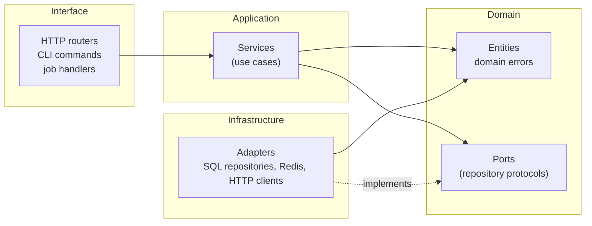

[Engineering handbook](../../README.md) / Principles

# Clean architecture

Buildruntime services separate business rules from the frameworks and infrastructure around them. The goal is practical: business rules that can be tested without a database, and infrastructure that can change without rewriting them. This page describes the layers, the one rule that holds them together, and where to stop.

## Layers



| Layer | Contains | Knows about |
| :-- | :-- | :-- |
| Domain | Entities, value objects, domain errors, and ports: the interfaces the application needs from the outside world. | Nothing outside the domain. |
| Application | Services that carry out one use case each, such as "archive a project". | The domain. |
| Interface | HTTP routers, CLI commands, queue consumers. They translate input into a service call and the result into output. | The application and the domain. |
| Infrastructure | Adapters that implement the ports: SQL repositories, cache clients, clients for other services. | The domain, and the libraries they wrap. |

## The dependency rule

Source code dependencies point inwards, towards the domain. The domain must not import from the application, interface or infrastructure layers, and the application must not import from infrastructure.

When a service needs something from the outside, such as loading a project, it depends on a port defined in the domain. The infrastructure layer provides the implementation, and the interface layer connects the two when it builds the service.

In practice:

- A domain module that imports `fastapi`, `sqlalchemy` or `redis` is a bug.
- A service never receives an HTTP request object or returns an HTTP response. It takes plain values and returns domain objects, or raises domain errors.
- Status codes, JSON shapes and SQL live at the edges.

## Example

The handbook uses one small service throughout: an API for projects, where each project has a unique slug and can be archived. These are its domain and application layers. The interface and infrastructure layers are in [FastAPI architecture](../backend/fastapi-architecture.md).

Domain errors carry a stable code, and no HTTP status. The interface layer decides how each error is presented (see [Error handling](../backend/error-handling.md)).

```python
# app/core/errors.py
class DomainError(Exception):
    """An expected failure that callers can handle or report to the user."""

    code = "domain_error"

    def __init__(self, message: str) -> None:
        super().__init__(message)
        self.message = message


class NotFound(DomainError):
    code = "not_found"


class Conflict(DomainError):
    code = "conflict"


class PermissionDenied(DomainError):
    code = "permission_denied"


class InvalidInput(DomainError):
    code = "invalid_input"
```

The entity is a plain, immutable dataclass. Rules that belong to a single project live on it.

```python
# app/projects/domain.py
from dataclasses import dataclass, replace
from datetime import datetime
from uuid import UUID

from app.core.errors import Conflict, NotFound


@dataclass(frozen=True, slots=True)
class Project:
    id: UUID
    slug: str
    name: str
    created_at: datetime
    archived_at: datetime | None = None

    @property
    def is_archived(self) -> bool:
        return self.archived_at is not None

    def archive(self, at: datetime) -> "Project":
        if self.is_archived:
            raise ProjectArchived(self.slug)
        return replace(self, archived_at=at)


class ProjectNotFound(NotFound):
    def __init__(self, slug: str) -> None:
        super().__init__(f"No project has the slug '{slug}'.")


class SlugTaken(Conflict):
    code = "slug_taken"

    def __init__(self, slug: str) -> None:
        super().__init__(f"The slug '{slug}' is already in use.")


class ProjectArchived(Conflict):
    code = "project_archived"

    def __init__(self, slug: str) -> None:
        super().__init__(f"The project '{slug}' is already archived.")
```

The port says what the application needs, in domain terms. `typing.Protocol` keeps the adapter free of any base class.

```python
# app/projects/ports.py
from datetime import datetime
from typing import Protocol
from uuid import UUID

from app.projects.domain import Project


class ProjectRepository(Protocol):
    async def get_by_slug(self, slug: str) -> Project | None: ...

    async def add(self, project: Project) -> None:
        """Store a new project. Raises SlugTaken if the slug is in use."""
        ...

    async def update(self, project: Project) -> None: ...

    async def list_page(self, *, after: tuple[datetime, UUID] | None, limit: int) -> list[Project]:
        """Return projects newest first, starting after the given position."""
        ...
```

The service implements the use cases. It depends on the port and on a clock, both passed in, so a test can control them.

```python
# app/projects/service.py
from collections.abc import Callable
from datetime import UTC, datetime
from uuid import UUID, uuid4

from app.projects.domain import Project, ProjectNotFound
from app.projects.ports import ProjectRepository


def utc_now() -> datetime:
    return datetime.now(UTC)


class ProjectService:
    def __init__(
        self, repository: ProjectRepository, clock: Callable[[], datetime] = utc_now
    ) -> None:
        self._repository = repository
        self._clock = clock

    async def create(self, *, name: str, slug: str) -> Project:
        project = Project(id=uuid4(), slug=slug, name=name, created_at=self._clock())
        await self._repository.add(project)
        return project

    async def get(self, slug: str) -> Project:
        project = await self._repository.get_by_slug(slug)
        if project is None:
            raise ProjectNotFound(slug)
        return project

    async def archive(self, slug: str) -> Project:
        archived = (await self.get(slug)).archive(at=self._clock())
        await self._repository.update(archived)
        return archived

    async def list_page(self, *, after: tuple[datetime, UUID] | None, limit: int) -> list[Project]:
        return await self._repository.list_page(after=after, limit=limit)
```

`create` does not check whether the slug exists before inserting it. Two concurrent requests could both pass such a check. The database's unique constraint is the only reliable guard, so the repository reports a violation as `SlugTaken` (see [FastAPI architecture](../backend/fastapi-architecture.md#repositories)).

## How far to take it

Clean architecture pays for itself when business rules are non-trivial or the infrastructure is likely to change. It is overhead for a service that only moves data between an HTTP request and a table.

- **Start with the dependency rule, not the folder structure.** Keeping SQL and HTTP out of the business rules gives most of the benefit. Separate packages for each layer are optional.
- **Do not add a port with one obvious implementation and no test that needs a fake.** A function that formats a date does not need an interface.
- **Do not map between identical models for the sake of it.** If the API response is exactly the entity, a schema that validates from the entity is enough.
- **Organise by feature first.** `app/projects/` with its domain, service, repository and router side by side is easier to navigate than `app/domain/`, `app/services/` and `app/repositories/`, each holding a file for every feature.

The same rule applies on the frontend: components render, hooks and Server Actions handle interaction, and data access lives in a module that the components call (see [Next.js](../frontend/nextjs.md#project-structure)).

## Related

- [Engineering principles](engineering-principles.md)
- [FastAPI architecture](../backend/fastapi-architecture.md)
- [Pytest](../quality/pytest.md#unit-tests-with-fakes), which tests the service with a fake repository
