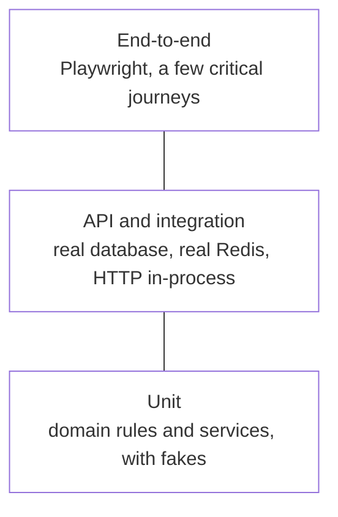

[Engineering handbook](../../README.md) / Quality

# Testing strategy

Tests exist so that changes can be made with confidence. A good test suite catches real defects, runs fast enough to run on every change, and fails only when something is actually wrong. This page sets out what to test at which level. The tools are covered in [Pytest](pytest.md) and [Playwright](playwright.md).

## Levels

| Level | Tests | Speed | Write them for |
| :-- | :-- | :-- | :-- |
| Unit | One function, class or component, with its dependencies replaced by fakes | Milliseconds | Business rules, calculations, edge cases, error branches |
| API and integration | A service's HTTP API, or a repository, against real PostgreSQL and Redis | Tens of milliseconds | The contract: status codes, response shapes, constraints, queries, transactions |
| End-to-end | The deployed application in a real browser | Seconds | The few journeys that must never break: sign-in, the core workflow, payment |

Most tests are unit and API tests. Each end-to-end test is expensive to run and to maintain, so they cover journeys, not features. If an end-to-end test fails and no lower-level test does, add the lower-level test that would have caught it.

## What to test

- **Behaviour, not implementation.** Test what the code does through its public interface, not how it does it. A test that breaks when a private function is renamed is a maintenance cost with no benefit.
- **The edges.** Empty input, one item, the maximum, invalid values, duplicates, time zones, concurrent requests.
- **The failure paths.** Every error a function can raise or return deliberately has a test that triggers it.
- **Every bug fix.** A fix comes with a test that fails without it, so that the bug cannot return unnoticed.

Do not test the framework or the language. A test that `ProjectCreate(name="x")` sets `name` to `"x"` tests Pydantic.

## Test doubles

Replace a dependency only when using the real one would make the test slow, flaky or impossible:

| Dependency | In unit tests | In API and integration tests |
| :-- | :-- | :-- |
| Own database | A fake repository | The real database, isolated per test |
| Redis | A fake, or the real thing if the test is about caching | Real Redis |
| Another team's or a third-party API | A fake or a stub | A stub server, or the provider's sandbox in a few contract tests |
| Time | A clock passed in, set by the test | The same |
| Randomness and IDs | Passed in, or asserted by shape rather than value | The same |

Prefer fakes, which are small working implementations, to mocks that assert which methods were called (see [Unit tests with fakes](pytest.md#unit-tests-with-fakes)).

## Test data

- Each test creates the data it needs, and does not depend on data from other tests or on the order tests run in.
- Use the smallest data that shows the behaviour. A test with forty fields set, when two matter, hides which two.
- Build test data with small factory functions that fill in sensible defaults, so that each test sets only the fields it cares about.
- In end-to-end tests that share an environment, make data unique per run, for example a slug with a random suffix, so that parallel runs do not collide.
- Never use production data in tests.

## Flaky tests

A test that sometimes passes and sometimes fails, with no change to the code, is a bug in the test or in the code. It also teaches everyone to ignore failures, which is worse.

- **Reproduce it.** Run it many times, in parallel, or in a different order: `playwright test --repeat-each=20`, or `pytest` with the pytest-randomly plugin, which shuffles the order on every run.
- **Fix the cause.** The usual ones: shared state between tests, depending on timing (`sleep`, or no wait for an asynchronous result), depending on the current time or on the order of an unordered result.
- **Do not hide it with retries.** Playwright retries in CI exist to capture a trace of the failure, and a test that passes only on retry is reported as flaky. Treat that report as a failure to fix.
- If it cannot be fixed straight away, open an issue, and decide with the team whether to remove the test until it is. A test that is disabled without a record is forgotten.

## Coverage

Measure coverage (`pytest --cov` with the pytest-cov plugin, or the coverage report of the frontend test runner) and look at it during review, to find code in a change that no test runs. Do not treat a percentage as a target: it measures which lines ran, not whether anything checked their result, and a target invites tests that execute code without asserting anything.

## Related

- [Pytest](pytest.md)
- [Playwright](playwright.md)
- [CI/CD](../delivery/ci-cd.md)
