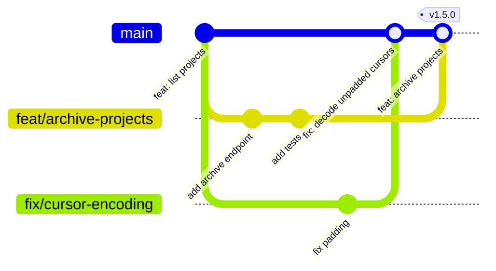

[Engineering handbook](../../README.md) / Workflow

# Git workflow

Buildruntime repositories use trunk-based development: `main` is the only long-lived branch, every change is made on a short-lived branch, and every branch is merged back through a pull request. This keeps integration continuous and `main` always releasable.

## Branches



Each merge in the diagram is a squash merge: the branch arrives on `main` as one commit, named after the pull request.

- **`main` is protected.** Nobody pushes to it directly. Changes arrive through pull requests that have passed review and every required check.
- **Branches are short-lived.** Aim to merge within a few days. A branch that lives for weeks diverges from `main` and becomes a painful merge. If a feature takes longer, merge it in smaller steps behind a feature flag.
- **One branch, one change.** A branch that fixes a bug and also refactors an unrelated module is two pull requests.
- **Delete branches after merging.** Enable automatic deletion of head branches in the repository settings.

### Naming

Name a branch after the type of change, as in [Conventional Commits](conventional-commits.md), and a short description in lowercase words separated by hyphens:

```text
<type>/<short-description>
```

Examples: `feat/archive-projects`, `fix/cursor-encoding`, `docs/redis-key-naming`, `chore/upgrade-sqlalchemy`. If the work has an issue, its number may follow the type: `fix/142-cursor-encoding`.

## Keeping a branch up to date

Rebase your branch on `main` rather than merging `main` into it, so that its history stays a straight line of your own commits:

```bash
git fetch origin
git rebase origin/main
# Resolve conflicts, then: git add <files> && git rebase --continue
git push --force-with-lease
```

`--force-with-lease` refuses to overwrite the remote branch if someone else has pushed to it since you last fetched. Never use plain `--force`.

Rebasing rewrites the branch's history, so only rebase branches that you alone are working on. On a shared branch, merge `main` in instead.

## Commits

- Commit in logical steps that each build and pass the tests. A reviewer should be able to read the history of a pull request one commit at a time.
- Write commit messages as described in [Conventional Commits](conventional-commits.md).
- Tidy the history before asking for review if it helps the reader: combine "fix typo" commits into the commit they fix with `git commit --fixup <sha>` and `git rebase -i --autosquash origin/main`.
- During review, add new commits rather than rewriting the ones already reviewed, so that the reviewer can see what changed.

Never commit:

- secrets, credentials or tokens, even in a commit that a later one deletes. They remain in the history. If it happens, rotate the secret immediately. Removing it from history does not make it safe again.
- generated files or build output, unless the project deliberately tracks them;
- large binary files. Use Git LFS or an artefact store if a repository needs them.

## Merging

Pull requests are merged with **squash and merge**. Each pull request becomes one commit on `main`, whose message is the pull request's title and description. The title must therefore be a valid Conventional Commit, because it is what the changelog and the version number are built from (see [Versioning and releases](../delivery/versioning-and-releases.md)).

Configure each repository to match:

- allow squash merging only, with the pull request title and description as the default commit message;
- require a pull request before merging, with at least one approval;
- require the CI checks to pass, and the branch to be up to date with `main`;
- dismiss approvals when new commits are pushed, if the repository holds production code;
- require a linear history.

## Useful commands

```bash
git switch -c feat/archive-projects origin/main   # Start a branch from the latest main
git add -p                                         # Stage changes hunk by hunk, and review them
git commit --fixup HEAD~2                          # Mark a fix for an earlier commit
git rebase -i --autosquash origin/main             # Fold fixups into their commits
git log --oneline origin/main..HEAD                # What this branch adds
git restore --staged app/main.py                   # Unstage a file
git reflog                                         # Find a commit you thought you had lost
```

## Related

- [Conventional Commits](conventional-commits.md)
- [Pull requests](pull-requests.md)
- [Versioning and releases](../delivery/versioning-and-releases.md)
